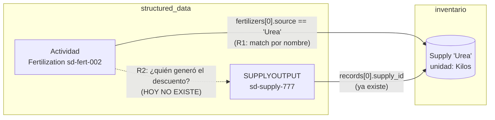
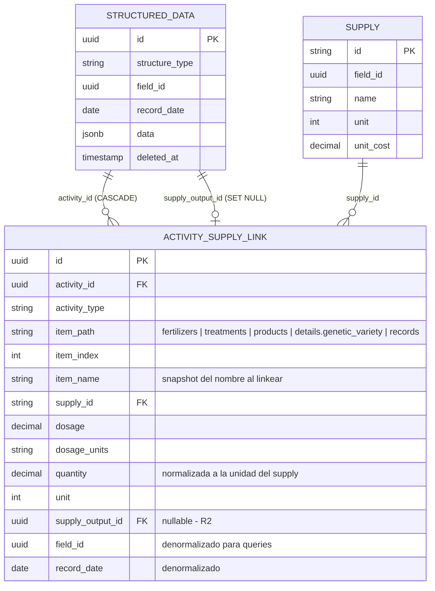
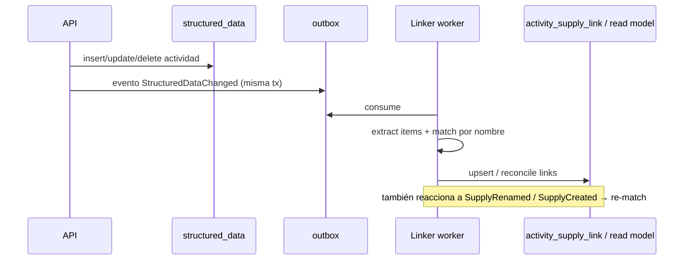

> **Documento de exploración.** Es la primera lectura del enunciado, anterior a la solución
> final. Varias conclusiones de acá cambiaron después: el recorrido está en
> [README.md](README.md) y la solución en el [README del repo](../../README.md).

# Challenge 2 — Análisis previo (actividades ↔ insumos)

> Documento de trabajo. Todavía no es el entregable: es la lectura del enunciado,
> las ambigüedades, 3 (+1) enfoques posibles y las preguntas a hacer.
> Los modelos base extraídos están en [`modelos_base.py`](modelos_base.py).

---

## 1. Qué entendí del problema

**Hoy:** actividades (`Plantation`, `Fertilization`, `Pulverization`, `TREATMENT`) y usos de insumo
(`SUPPLYOUTPUT`) son entries sueltas de *structured data*, cada una con su UUID. Los items de las
actividades nombran al insumo como **texto** (`source`, `name`, `genetic_variety`). El único que ya
apunta a inventario por id es `SUPPLYOUTPUT.records[].supply_id`.

**Hay en realidad DOS relaciones mezcladas en el enunciado:**

| # | Relación | De dónde sale | Para qué sirve |
|---|----------|---------------|----------------|
| R1 | **Item de actividad → Insumo de inventario** (`Supply`) | Regla de matching por nombre | Saber qué insumo, qué unidad, cuánto se aplicó, costo |
| R2 | **Actividad → SUPPLYOUTPUT** (padre → hijo) | Flujo "Descontar del inventario" (captura A.3) | Que el tab Datos muestre el uso de insumo como fila hija |

El enunciado pide R1 explícitamente ("modelo de relación actividad↔insumo") y R2 aparece en la parte BFF
(`sd-supply-777` pertenece a `sd-fert-002`). **Un buen diseño tiene que cubrir las dos**, y la pieza
común es el `id` UUID de structured data ("es la pieza sobre la que vas a colgar la relación").



### Puntos finos que salen de leer los schemas

- **Los items no tienen id propio.** `fertilizers[]`, `treatments[]`, `products[]` son listas de
  objetos sin identificador → para reconciliar en un update hay que decidir la clave del item
  (índice, nombre, o agregar un `item_id`). Es *el* problema de diseño del CRUD.
- **La genética de Plantation no es una lista**: es un campo escalar (`details.genetic_variety`).
  El modelo de link tiene que soportar "item" en un path no-lista.
- **Opcionales por todos lados:** en `Plantation` `source` es `Optional` → item sin nombre = no linkeable.
  En `TREATMENT` todo `products` es opcional.
- **Unidades heterogéneas:**
  - Agro: dosis **por hectárea** (`L/ha`, `kg/ha`, `g/ha`, `cc/ha`) × hectáreas de los lotes = total.
    Captura A.3: 2 L/ha → descuenta 50 L (⇒ 25 ha).
  - Hacienda (`TREATMENT`): dosis **absoluta** (`ml`, `cc`, `g`, `kg`, `L`), lotes **sin hectáreas**.
    ¿La dosis es por cabeza? ¿total?
  - Siembra: densidad en `seeds/ha`, `plants/ha`, `kg/ha` vs insumo semilla en "bolsas"/"kg".
  - Inventario: unidad del supply es un `int` (enum: Litros, Kilos, Metros, Rollos…).
  - ⇒ "qué unidad corresponde a cada insumo dentro de la actividad" = **la del supply**, y la
    cantidad hay que convertirla. Conviene persistir en el link tanto la dosis original como la
    cantidad normalizada a la unidad del supply.
- **`SUPPLYOUTPUT` aparece en la tabla de "actividades con items linkeables"**, pero su record no tiene
  nombre, tiene `supply_id`. Para él el link R1 es directo (por id), no por nombre.
- **`SUPPLYOUTPUT.basic_info.lote` es un string único**, las actividades tienen hasta 5 lotes.
  ¿Una pulverización en 3 lotes genera 1 SUPPLYOUTPUT o 3?
- **El tab Datos hoy pone los SUPPLYOUTPUT al final** — en el after deberían anidarse bajo el padre y
  solo los sueltos (sin padre) quedar como filas propias (captura A.4: "el resto sigue como filas sueltas").
- **El `BasicInfo` de supplies choca de nombre con el de agro** (detalle, pero muestra que son módulos separados).
- Las imágenes del apéndice (`img/a*.png`) **no están en la carpeta**; me baso en las descripciones.

---

## 2. Requisitos destilados

1. **Explícita**: la relación se persiste al escribir, no se infiere al leer.
2. **Robusta**: sobrevive a renames, reordenamientos de items, borrados; tiene integridad (FK / unique).
3. **Consultable**: "¿qué insumos usó la actividad X?", "¿en qué actividades se usó el insumo Y?",
   "¿cuánto Urea se aplicó en el campo Z entre fechas?", "costo por lote/campaña" — **con índices, sin
   abrir el JSON**.
4. **CRUD claro**: crear → se generan links; update → reconciliación (¿actividad = fuente de verdad?);
   delete → cascada / soft delete / qué pasa con el SUPPLYOUTPUT hijo.
5. **BFF**: el feed devuelve el padre con los insumos ya resueltos; paginación sobre padres.

---

## 3. Enfoques posibles

### Enfoque A — Tabla de link normalizada a nivel item (junction table) ⭐ candidato principal

Una tabla relacional `activity_supply_link`, **una fila por item linkeado**, escrita por la capa de
servicio **en la misma transacción** que la structured data. R2 se resuelve con una columna
`supply_output_id` en la misma fila (el SUPPLYOUTPUT que descontó ese item).



Índices: `(activity_id)`, `(supply_id, record_date)`, `(field_id, record_date)`,
`(supply_output_id)`, `UNIQUE(activity_id, item_path, item_index)`.

```python
# Esqueleto del CRUD (ilustrativo)
def create_activity(cmd) -> StructuredData:
    with tx():
        sd = repo.insert(cmd.structure)
        links = build_links(sd, supplies_by_name(sd.field_id))   # aplica la regla de matching
        link_repo.bulk_insert(links)
        return sd

def update_activity(sd_id, new_structure):
    with tx():
        sd = repo.update(sd_id, new_structure)          # la actividad es fuente de verdad
        desired = build_links(sd, supplies_by_name(sd.field_id))
        current = link_repo.by_activity(sd_id)
        reconcile(current, desired)                      # diff por clave de item: insert/update/delete

def delete_activity(sd_id):
    with tx():
        repo.soft_delete(sd_id)
        link_repo.delete_by_activity(sd_id)              # o FK ON DELETE CASCADE
        # ¿y los SUPPLYOUTPUT hijos? → pregunta abierta (ver §5)
```

| Pros | Contras |
|------|---------|
| Explícito, con FK e índices; consultas de agregación triviales (SQL puro) | Doble escritura (JSON + tabla) → hay que garantizar que no divergen (misma tx) |
| Soporta "un item ↔ un supply" y R2 en la misma fila | La clave del item (`item_index`) es frágil ante reordenamientos |
| Denormalizar `field_id`/`record_date` habilita reportes sin join a SD | Un esquema por "item" algo genérico (`item_path` string) |
| Fácil de explicar y defender | Si cambia el nombre del supply, hay que decidir si se re-matchea |

### Enfoque B — Referencia embebida en el JSON + índices sobre JSONB

Se extiende cada item del schema con `supply_id: Optional[str]` (como ya tiene `Record`) y la
actividad padre en `SUPPLYOUTPUT` (`origin_activity_id`). Se resuelve el match al escribir y se
guarda dentro del propio documento. Consultable con **índice GIN / columnas generadas** sobre
`jsonb_path_query(data, '$.fertilizers[*].supply_id')`.

```python
class Fertilizer(BaseModel):
    source: str
    supply_id: Optional[str] = None   # NUEVO: resuelto al escribir por match de nombre
    dosage: Optional[float] = None
    dosage_units: Optional[Literal["L/ha", "kg/ha"]] = None

class SUPPLYOUTPUT(BaseStructure):
    basic_info: BasicInfo
    origin_activity_id: Optional[UUID] = None  # NUEVO: R2
    records: list[Record] = []
```

| Pros | Contras |
|------|---------|
| Una sola fuente, sin doble escritura ni divergencia | Rozando lo que el enunciado pide evitar: la relación vive "dentro del JSON" |
| Cambio mínimo, el item y su link no se separan nunca (no hay problema de clave de item) | Sin FK real → integridad a mano (supply borrado = id colgando) |
| Natural para el front (el item ya trae su supply) | Índices JSONB por cada path distinto de cada tipo; agregaciones más caras/feas |
| | Migrar todos los schemas (5 tipos) y versionarlos |

### Enfoque C — Proyección derivada por eventos (read model asíncrono)

La structured data sigue igual. Cada create/update/delete emite un evento (outbox); un **linker**
(worker) aplica la regla de matching y mantiene una tabla de links / read model (puede ser la misma
tabla del enfoque A, o directamente una tabla de `record_summary` ya armada para el BFF).



| Pros | Contras |
|------|---------|
| Desacopla escritura de linkeo; no toca el path crítico | **Consistencia eventual**: el usuario guarda y el link aparece "un rato después" |
| Re-matcheo retroactivo natural (supply creado o renombrado después) | Más infra (outbox, worker, reintentos, idempotencia) |
| Backfill del histórico = re-procesar eventos | Más difícil de razonar/debuggear; sobre-ingeniería para el alcance |

### Enfoque D — Tabla genérica de relaciones entre entries de SD (grafo de aristas)

Una tabla `structured_data_relation(source_id, target_id, relation_type, source_item_ref, metadata jsonb)`
que modela cualquier vínculo entre entries: `CONSUMES_SUPPLY` (actividad→supply),
`GENERATED_OUTPUT` (actividad→SUPPLYOUTPUT), y a futuro otros (cosecha→siembra, etc.).

| Pros | Contras |
|------|---------|
| Extensible a otras relaciones sin nuevas tablas | Polimórfica: FK débiles, `metadata` vuelve a ser JSON sin tipar |
| Una sola forma de consultar "lo relacionado con X" | Cantidad/unidad/costo quedan en `metadata` → se pierde consultabilidad de lo que justamente importa |
| | Abstracción prematura |

### Comparativa rápida

| Criterio | A · junction | B · embebido | C · eventos | D · grafo genérico |
|---|---|---|---|---|
| Explícito | ✅ | 🟡 | ✅ | ✅ |
| Integridad (FK) | ✅ | ❌ | ✅ | 🟡 |
| Consultable / agregable | ✅ | 🟡 | ✅ | 🟡 |
| Consistencia inmediata | ✅ | ✅ | ❌ | ✅ |
| Complejidad | media | baja | alta | media |
| Re-match retroactivo | manual (job) | manual | ✅ natural | manual |

**Inclinación inicial:** **A** como núcleo (tabla de link a nivel item, escrita sincrónicamente en la
misma tx), tomando de **B** la idea de guardar el `supply_id` resuelto *también* como snapshot opcional
si el front lo necesita, y dejando **C** como evolución (job de re-match / backfill) mencionado en el
README como trade-off. Para el item key, proponer agregar `item_id` (UUID) a cada item a futuro, y
mientras tanto usar `(item_path, item_index)` + `item_name` para reconciliar.

---

## 4. BFF tab «Datos» — primera idea del *after*

- Los `SUPPLYOUTPUT` con padre **dejan de ser filas top-level** y aparecen dentro de su actividad.
- Cada actividad trae `supplies[]`: un elemento por item linkeado, con el insumo resuelto, unidad,
  dosis, cantidad total y (si existe) el `record_locator` del SUPPLYOUTPUT que lo descontó.
- Items no linkeados (texto libre sin match) se muestran igual pero con `supply: null`.
- Los `SUPPLYOUTPUT` sin padre siguen como filas sueltas (como en A.4).
- `total` cuenta solo filas top-level → paginación estable.

```jsonc
{
  "record_locator": "sd-fert-002",
  "detail": "FERTILIZATION",
  "record_date": "2026-03-12",
  "summary": "Fertilización — Lote Sur — Urea 10 kg/ha",
  "structure": { "...": "igual que antes" },
  "supplies": [
    {
      "item": { "path": "fertilizers", "index": 0, "name": "Urea" },
      "supply": { "id": "sup-urea", "name": "Urea", "unit": "Kilos" },
      "dosage": { "value": 10, "units": "kg/ha" },
      "quantity": { "value": 100, "unit": "Kilos" },
      "supply_output": {
        "record_locator": "sd-supply-777",
        "summary": "Se utilizó el siguiente insumo en el lote Lote Sur: Urea (100 Kilos)"
      }
    }
  ]
}
```

A decidir: ¿`children` genérico (para que el front renderice filas hijas sin conocer el tipo) o
`supplies` tipado? ¿El hijo hereda la fecha del padre para ordenar?

---

## 5. Preguntas para hacer

### Regla de matching
1. ¿"Mismo nombre" es igualdad exacta o normalizada (trim, mayúsculas, acentos)? `"Urea"` vs `"urea "`.
2. ¿El match se busca en el inventario **de qué alcance**: campo, establecimiento, cuenta/organización?
3. ¿Los nombres de insumo son únicos dentro de ese alcance? Si hay dos "Urea", ¿cuál gana / no se linkea?
4. Si el usuario eligió "Seleccionar de inventario" ya tenemos el `supply_id`: ¿igual aplica la regla
   por nombre, o el id elegido manda?
5. Si se **renombra** el insumo en inventario, ¿el link se rompe (regla estricta por nombre) o se
   conserva (link por id ya persistido)?
6. Si se **crea** un insumo después de la actividad con un nombre que coincide, ¿se linkea
   retroactivamente?
7. ¿Puede una actividad tener dos items con el mismo nombre (ej. Urea dos veces con distinta dosis)?

### Relación actividad → SUPPLYOUTPUT
8. ¿El SUPPLYOUTPUT se crea siempre desde el form de la actividad ("Descontar del inventario") o
   también se carga independientemente y después se quiere asociar?
9. ¿Una actividad multi-lote genera un SUPPLYOUTPUT por lote o uno solo? (`basic_info.lote` es un único string)
10. ¿Un SUPPLYOUTPUT agrupa varios items de la actividad (varios records) o es uno por item?
11. ¿Se puede editar el SUPPLYOUTPUT hijo por separado? ¿Qué pasa si diverge de la actividad?

### CRUD
12. Update: ¿la actividad es fuente de verdad? Si cambio la dosis, ¿se recalcula el SUPPLYOUTPUT
    (y el stock)? Si saco un item, ¿se borra su SUPPLYOUTPUT y se repone stock?
13. Delete: ¿hard o soft delete en structured data? ¿Borrar la actividad borra/repone el SUPPLYOUTPUT,
    o lo deja huérfano como fila suelta?
14. ¿Hay versionado/historial de structured data que debamos respetar?
15. ¿Qué pasa con el histórico ya cargado? ¿Se espera un backfill del linkeo?

### Unidades / cantidades / costo
16. ¿Cómo se convierte dosis → unidad del supply? (L/ha × ha → Litros; cc/ha → Litros; g/ha → Kilos).
    ¿Y genética (semillas/ha vs bolsas)?
17. En `TREATMENT`, ¿la dosis es por cabeza o total? (no hay hectáreas)
18. ¿El costo sale de un precio en el supply (último, promedio ponderado) o del SUPPLYOUTPUT?
    ¿Se congela al momento de la actividad?
19. ¿Qué es `Record.unit` (int)? ¿Hay un enum de unidades de inventario que podamos ver?

### BFF / producto
20. ¿El front prefiere un `children` genérico o un bloque `supplies` tipado?
21. ¿Paginación y `total` cuentan solo padres? ¿`new_records` incluye hijos?
22. Si el SUPPLYOUTPUT tiene fecha distinta del padre, ¿se muestra igual anidado?
23. ¿Se quieren mostrar items **no linkeados** (texto libre) como "insumo no inventariado"?

### Técnicas
24. ¿Qué motor de base hay detrás de structured data (Postgres JSONB, Mongo, …)? Cambia la viabilidad de B.
25. ¿Hay infraestructura de eventos/outbox ya existente? (cambia el costo de C)
26. ¿Los items de lista podrían recibir un `item_id` estable? (resuelve la reconciliación en updates)

---

## 6. Próximos pasos propuestos

1. Elegir enfoque (recomiendo A + snapshot de B, C como evolución).
2. Fijar supuestos para las preguntas que no nos respondan (y documentarlos en el README).
3. Escribir: esquema (SQL/SQLAlchemy), `build_links` por tipo (extractor por `LINKABLE_ITEMS`),
   `reconcile`, payloads de los 5 tipos, mock completo del after, README de decisiones.
